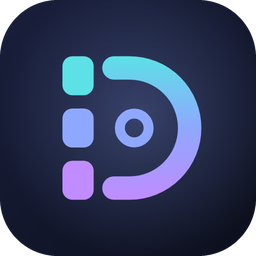
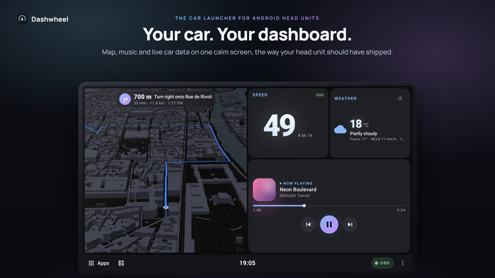
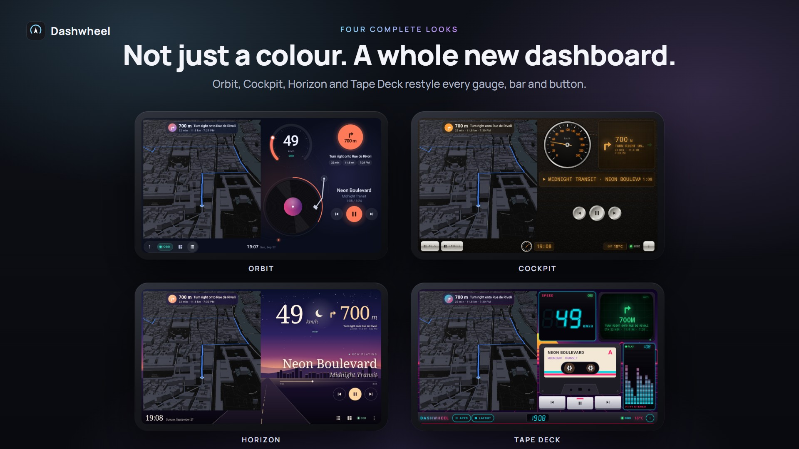
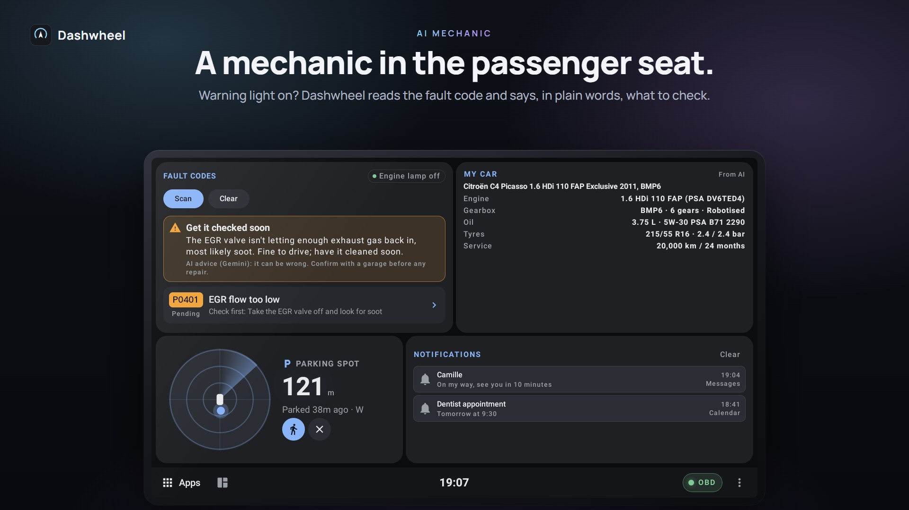
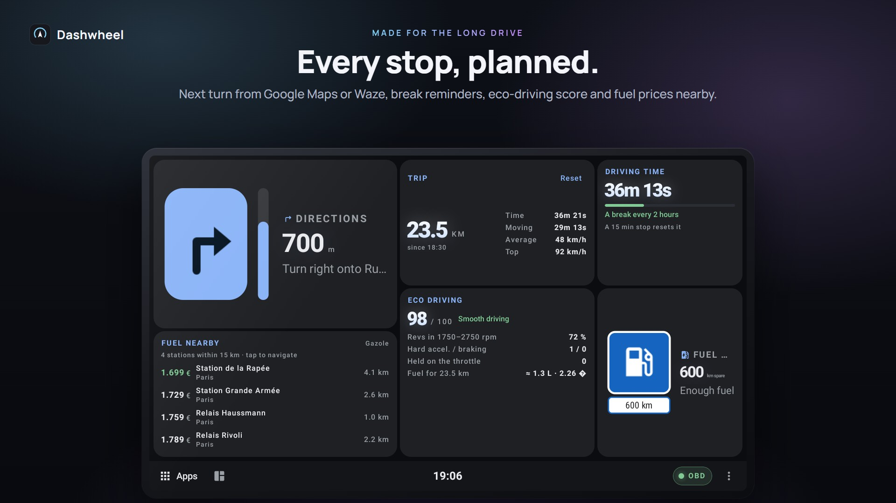
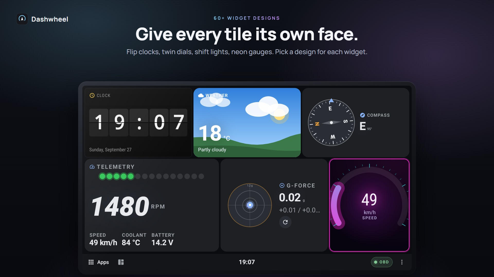
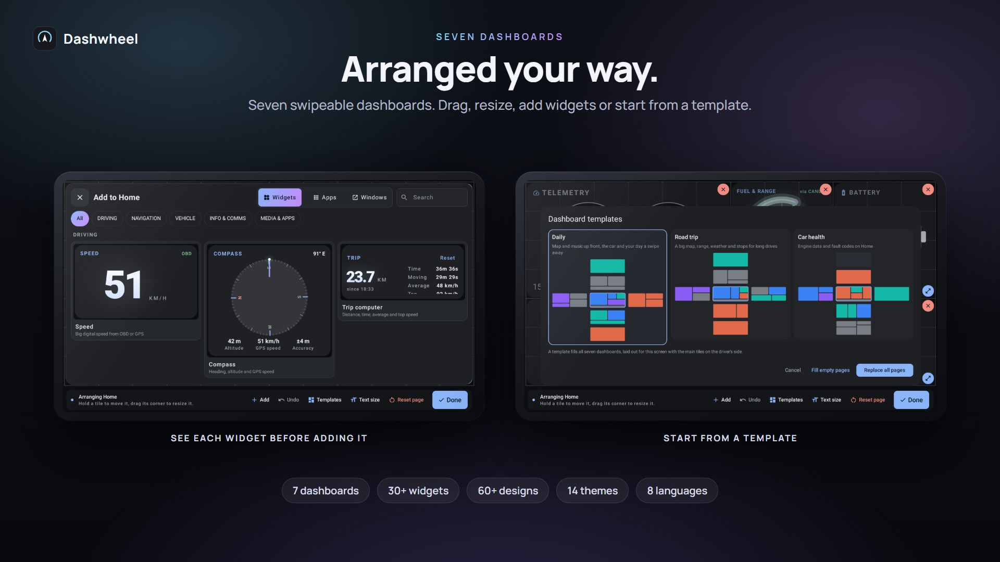
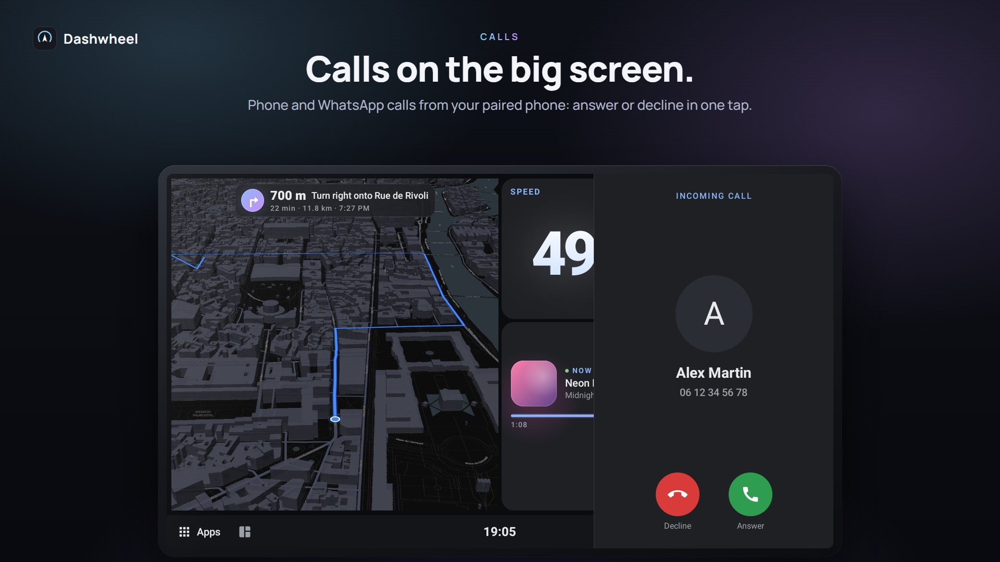
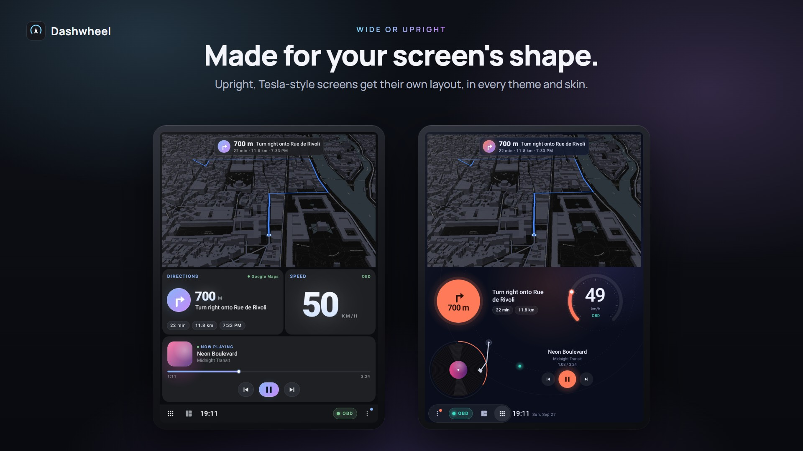

# Dashwheel

**The free car launcher for Android head units (QF, FYT, Microntek and more).** Map, music and live car data on one calm screen: up to seven dashboards you arrange yourself, 55+ widgets, whole-design skins, an AI mechanic that explains warning lights, and your phone's calls and messages on the big screen. No ads, no trial, no account.

**[Download the latest release](https://github.com/deviloufr-ai/Dashwheel/releases/latest)** · Android 9+ · fits any screen size: wide head units of any resolution (ROCO K706 / FYT / QF), upright screens and phones.

📖 **[Read the wiki](https://github.com/deviloufr-ai/Dashwheel/wiki)** for every feature, setup guides and what works with or without root.

**Will it work on my unit?** See [supported head units](#supported-head-units) and [tested hardware](https://github.com/deviloufr-ai/Dashwheel/wiki/Tested-Hardware). Root is not needed.

Dashwheel is free, with no ads. If it makes your drives nicer, a coffee on Ko-fi keeps it going.

## Screenshots

| | |
|---|---|
|  |  |
| **Live car data** from a Bluetooth OBD adapter and the head unit's CAN box | **AI mechanic**: fault codes explained in plain words |
|  |  |
| **Road trip**: next turn, break reminder, eco score, fuel prices nearby | **60+ widget designs**, one per tile |
|  |  |
| **Whole-design skins**: Panorama, Cockpit, Racing, Orbit, Canvas and more | **Your dashboards**, live widget previews, templates |
|  |  |
| **Calls** from the paired phone, answered from the screen | **Upright screens** get their own layout |

## Highlights

- **Dashboards your way**: free grid, drag to move and resize, templates, Canvas theme with the map behind the tiles
- **Live car data**: ELM327 Bluetooth OBD, the head unit's own car data (doors, fuel, tyres, reversing), and a USB TPMS receiver of your own
- **AI mechanic** (free Google Gemini key): fault codes explained and spoken, start-up briefing, car care and servicing reminders
- **Navigation**: free built-in 3D map with turn-by-turn guidance, or Google Maps / Waze next turn on any tile
- **Phone link** (Dashwheel Companion app): notifications, messages, calls, where's my car, drive log
- **Your own alerts and reverse view** instead of the head unit's pop-ups
- **Road watch** (experimental, Dashwheel Companion): the phone in a windscreen holder watches the road with its camera; the car warns of a car ahead coming up fast, a wheel on the lane's line, following too close, and traffic moving off. Its **road recorder** (experimental too) keeps a one-minute clip around a knock, a hard brake, a warning or the hazard lights, with the time, place and the car's own speed in the picture, on the phone only
- **Hands-free**: spoken alerts, steering-wheel buttons, volume that follows speed
- **Share and automate**: share a dashboard and its look as a QR code or a short code; Tasker and similar apps can drive Dashwheel and react to the car ([automation](docs/automation.md))
- **Second screen** (experimental): a Raspberry Pi drives a second monitor in the car
- **11 languages**, day and night themes, updates from GitHub Releases on a stable or a beta channel
- **Root is optional**: extra features appear only when the unit allows them ([what needs what](https://github.com/deviloufr-ai/Dashwheel/wiki/Root-and-PMPatch3)); without root, [Shizuku](https://shizuku.rikka.app/) brings the shell features (app windows, the car app's switches, the volume keys)

## Supported head units

Any Android 9+ head unit runs Dashwheel as a launcher. On top of that, Dashwheel works out which firmware family the unit runs and talks to that firmware (ignition, wheel keys, the CAN box's car data, the unit's Bluetooth phone):

| Family | Typical units | Status |
|---|---|---|
| **QF** | Hizpo / ROCO K706 (UIS7862, UIS8581a) | Everything; the developer's own unit, daily use |
| **FYT / SYU** | Joying, Atoto, Mekede, Junsun, Idoing, Isudar, NaviFly, Sinosmart, Winca, DUDU | Full support, waiting for testers |
| **Microntek MTCD / MTCE, HCT MTCH** | Dasaita, Xtrons PX5 / PX6, Eonon, Pumpkin, Erisin | Full support, waiting for testers |
| **Topway TS**, **Reglink**, **Allwinner**, **Nowadays** | TS10 / TS18, MediaTek AC8227L / AC8257, T3 / T8, K4811 | Basics: plain Android, ignition and key broadcasts, help against the firmware's app killer |
| Anything else | plain Android units, tablets, phones | Works as a launcher |

What each family gives, and how to help confirm yours: [Supported head units](https://github.com/deviloufr-ai/Dashwheel/wiki/Supported-Head-Units) on the wiki. Technical details: [docs/unit-platforms.md](docs/unit-platforms.md). Your unit works? Settings → General → About → **Report how it works**.

## Two editions

- **GitHub edition** (`Dashwheel-<version>.apk` from [Releases](https://github.com/deviloufr-ai/Dashwheel/releases/latest)): the full app. Root, Shizuku, internal ADB and PMPatch3 features appear when the unit allows them, and it updates itself from GitHub Releases.
- **Google Play edition**: the same app without the features that need root, the unit's internal ADB or PMPatch3. It never installs anything itself: updates come from Google Play, and the Companion comes from Play too. Store texts and the privacy policy are in `fastlane/metadata-play/` and `docs/play/`.

| | GitHub | Google Play |
|---|---|---|
| Dashboards, widgets, skins, OBD, map, AI mechanic, phone link | yes | yes |
| Self-update from GitHub, Ko-fi link | yes | no (Play updates it) |
| System-app install, boot logo, Google Maps inside a tile (PMPatch3), reverse camera takeover, firmware pop-up and volume bar replacement, CAN car data from the unit's MCU, Signal Finder | when the unit allows it | no |
| Accessibility service (split screen, typing from the phone, wheel buttons) | turned on by the app where there is a root shell | turned on by you in Android's settings, after an in-app explanation |

## Get started

1. Install `Dashwheel-<version>.apk` on the head unit and set it as the Home app.
2. Optional: `dashwheel-companion.apk` on your phone, an ELM327 Bluetooth adapter, a free Gemini key.
3. Follow the first-run setup and the tour.

Updates: Dashwheel updates itself from the stable channel. Turn on **Settings, About, Beta updates** to get each new version as soon as it is built; a beta becomes stable once it has been tried.

Details: [Installation and updates](https://github.com/deviloufr-ai/Dashwheel/wiki/Installation-and-Updates) · [Troubleshooting](https://github.com/deviloufr-ai/Dashwheel/wiki/Troubleshooting)

## iPhone owners

The Dashwheel Companion app is Android only, so an iPhone gets no notifications, messages, drive log, phone GPS or "where's my car" on the head unit. Everything else works without it:

- dashboards, widgets and skins, the built-in map and turn-by-turn guidance
- live car data from an OBD adapter and the head unit's CAN box, the AI mechanic, servicing reminders
- calls through the head unit's own Bluetooth (on ROCO K706 / QF units), and its radio and Bluetooth music
- CarPlay, where the head unit has it, next to Dashwheel

## Feedback and support

- Something broken, or a unit that isn't listed? In the app, **Settings, About, Report how it works** fills in a GitHub issue with your unit's model and firmware (a QR code for your phone). Or [open an issue](https://github.com/deviloufr-ai/Dashwheel/issues/new/choose) yourself.
- After a crash, Dashwheel offers to send the error the next time it starts, once the car is parked.
- If Dashwheel is useful to you, a ⭐ on this repo helps other drivers find it.
- [Ko-fi](https://ko-fi.com/deviloufr) pays for test hardware.

## Branded builds and commercial licences

Installers and resellers: custom or branded builds, and licences for closed distribution, are available. [Get in touch](https://deviloufr-ai.github.io/alexandreleblanc.github.io/).

## Build from source

Android Studio with a Gradle JDK of 17–21, then `./gradlew assembleDebug`. Toolchain, modules, CI and release signing: [Building from source](https://github.com/deviloufr-ai/Dashwheel/wiki/Building-from-Source). Pull requests are welcome: see [CONTRIBUTING.md](CONTRIBUTING.md).

## License

Copyright (C) 2026 Alexandre Leblanc (deviloufr-ai)

**The app is free. The code is not open source.**

- You can download and use Dashwheel and the Companion app for free.
- The code is public so you can read it, report bugs and send fixes.
- You may not copy the code into other projects, publish modified builds, sell it or pre-install it on devices without written permission.

Full terms in [LICENSE](LICENSE). Versions up to commit fed7d976 were released under the GPL v3 and stay under it. For branded builds or pre-installation, [get in touch](https://deviloufr-ai.github.io/alexandreleblanc.github.io/).
